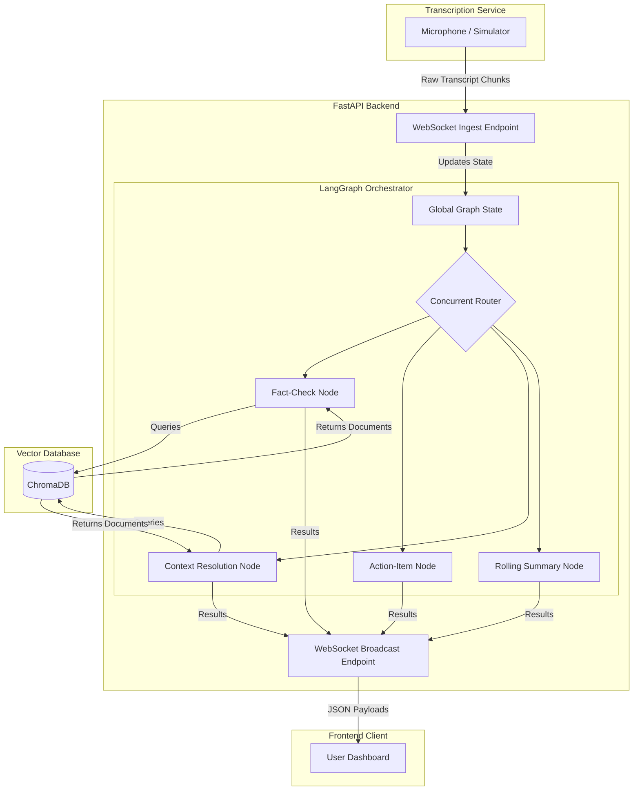
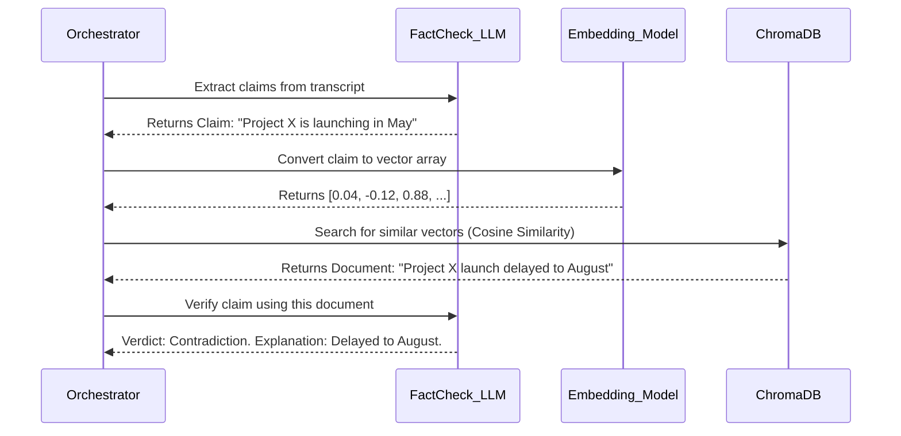
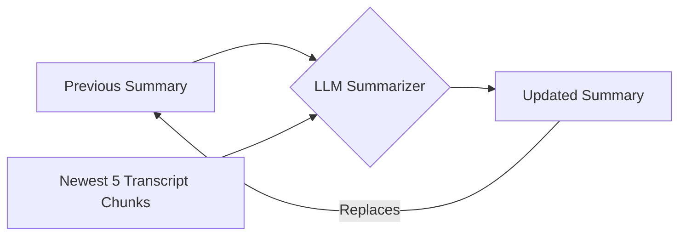

Live Meeting Intelligence Copilot — Comprehensive Technical Project Details
===========================================================================

Introduction and Core Vision
----------------------------
In modern corporate environments, meetings are often fast-paced, dense with information, and heavily reliant on historical context that not everyone in the room might possess. A single meeting can generate dozens of action items, reference obscure internal metrics, and involve bold claims about competitors that often go unchecked until long after the meeting has concluded. The manual process of taking notes, verifying claims, defining tasks, and summarizing the discussion is incredibly time-consuming and prone to human error. Our vision for this project was to completely automate that cognitive load. We sought to build an artificial intelligence copilot that sits in the meeting with you, listens to the conversation in real-time, and provides immediate, actionable intelligence on a visual dashboard without any human intervention.

We wanted this system to go far beyond simple transcription. Transcription is a solved problem. The real challenge is extracting structured meaning from that transcription as quickly as the words are spoken. To achieve this, we conceptualized a system that uses an entire team of AI "agents," rather than a single AI model. By splitting the cognitive workload into specialized tasks, we ensure that the system can fact-check a claim against internal documents at the exact same moment another part of the system is writing down a task for a team member. This document serves as a deep dive into the engineering, architecture, algorithms, and complex debugging processes that went into bringing this vision to life.

The Technological Foundation
----------------------------
To build a system capable of handling high-speed, concurrent data processing, we had to be extremely deliberate in our choice of technologies. The backend infrastructure is built entirely on Python 3.12. Python was chosen not only because it is the undisputed king of the artificial intelligence and machine learning ecosystem, but because modern Python features excellent support for asynchronous programming. When dealing with live audio transcripts and multiple AI models communicating simultaneously, synchronous code would freeze the entire application every time it waited for an API response. Asynchronous Python allows thousands of operations to run concurrently.

At the heart of the backend is FastAPI, a modern, high-performance web framework. FastAPI is uniquely suited for this project because it treats WebSockets as a first-class citizen. Unlike traditional HTTP requests where a browser asks for a webpage and the server responds once, WebSockets create a persistent, bi-directional tunnel between the browser and the server. This means that as soon as an AI agent finishes processing an insight, FastAPI can push that insight directly to the user's screen in milliseconds, without the user ever having to refresh the page.

For the artificial intelligence engine, we utilized the Groq API. Traditional Large Language Models hosted on standard graphics processing units can take several seconds to generate a response. In a live meeting, a five-second delay is unacceptable; the conversation will have already moved on. Groq utilizes specialized hardware called Language Processing Units (LPUs) that are physically designed to run models like Llama 3 at hundreds of tokens per second. This near-instantaneous inference speed is the backbone of our real-time promise.

To orchestrate the complex logic required for the AI, we heavily relied on the LangChain ecosystem, specifically LangGraph. LangChain provides the foundational tools for connecting to language models, formatting prompts, and parsing responses into structured data. LangGraph, however, is what makes the multi-agent system possible. It is a framework for defining complex, stateful workflows as a mathematical graph, where data flows from one intelligent node to another. 

For the knowledge base, we integrated ChromaDB, an open-source, embedded vector database. Unlike traditional SQL databases that search for exact text matches, ChromaDB searches based on semantic meaning. When we store company documents in ChromaDB, we convert the text into high-dimensional numerical arrays called vectors. We generate these vectors using ONNXRuntime and a lightweight, highly efficient machine learning model called MiniLM. This allows the system to run the embedding process entirely locally on the CPU, removing the need for heavy, complex GPU dependencies like PyTorch, which is a crucial architectural decision we will discuss later in the debugging section.

The frontend dashboard is a testament to the power of modern web standards. We built it using pure, vanilla HTML, CSS, and JavaScript. In an era dominated by heavy JavaScript frameworks like React, Vue, and Angular, choosing vanilla web technologies might seem counter-intuitive. However, this dashboard does not require complex state routing or interactive forms; it is primarily a display layer for incoming WebSocket data. By using vanilla technologies, the frontend is incredibly lightweight, requires zero build steps or compilation, and renders instantly in the browser. The styling utilizes modern CSS variables, CSS Grid, and Flexbox to create a dark-themed, glowing, highly responsive interface that looks and feels like a premium enterprise application.

Architectural Overview and Data Flow
------------------------------------
Understanding how data moves through the Live Meeting Intelligence Copilot requires looking at the system as a pipeline of events. The process begins when a participant speaks. In a production environment, an audio transcription service would convert this speech to text. For our purposes, the Meeting Simulator plays this role, reading a transcript file and firing off small chunks of text to the server every few seconds.

When a chunk of text arrives at the FastAPI server via the WebSocket ingest endpoint, it is immediately placed into the LangGraph orchestrator. This orchestrator acts as the brain of the operation. It maintains a "State Dictionary" which holds the entire history of the meeting, the current chunk of text, and the accumulated insights from previous minutes. 

The orchestrator takes the new text and fans it out to four separate AI agents simultaneously. Because these agents do not rely on each other to do their jobs, they execute in parallel. This is a massive performance optimization. While the Fact-Check agent is busy searching the database, the Action-Item agent is already parsing the text for tasks.

Below is a detailed flowchart illustrating this concurrent architecture.

Deep Dive into the AI Agents
----------------------------
The true intelligence of the system lies in how we prompt and manage the four distinct AI agents. Each agent is a highly specialized instance of the Groq Llama 3 model, instructed to look for specific patterns and return data in a strictly formatted JSON structure.

### 1. The Fact-Check Agent
The Fact-Check agent is arguably the most complex node in the system. Its job is to listen to the conversation, identify if a speaker is making a factual claim, and verify that claim against the company's private knowledge base. To do this, it employs an algorithm known as Retrieval-Augmented Generation (RAG). 

When the agent receives a transcript chunk, it first uses the language model to extract any claims. If a claim is found, it converts that claim into a vector embedding. It then asks ChromaDB to perform a mathematical operation called Cosine Similarity. Cosine Similarity measures the angle between two vectors in high-dimensional space to determine how closely related they are in meaning. ChromaDB returns the top three most relevant snippets of text from the company's internal documents.

The agent then takes the original claim, alongside the retrieved documents, and feeds them both back into the language model. The prompt explicitly instructs the model: "You are a strict fact-checker. You may only use the provided documents to verify the claim. If the documents do not contain the answer, you must state that it is unverifiable." The model then outputs a JSON object containing a verdict (Verified, Contradiction, or Unverifiable), an explanation, and the source citations.

### 2. The Action-Item Agent
The Action-Item agent focuses entirely on identifying tasks, commitments, and deadlines. It scans the transcript for action-oriented language. The prompt for this agent is heavily engineered to avoid false positives. For example, if someone says "I might look into that," the agent should ignore it. But if a manager says, "Sarah, please have the Q3 financial report on my desk by Thursday," the agent springs into action.

The agent uses a schema-enforced JSON output to guarantee it always returns a structured object containing the "task" description, the "assignee" (Sarah), and the "deadline" (Thursday). By forcing the language model to adhere to this schema, the frontend dashboard can blindly trust the incoming data and render it beautifully without needing to parse messy strings.

### 3. The Context Resolution Agent
Corporate meetings are notoriously filled with acronyms, code names, and jargon that new employees or external stakeholders might not understand. The Context Resolution agent operates similarly to the Fact-Check agent, utilizing the RAG pipeline. However, instead of looking for claims to verify, it specifically hunts for capitalized acronyms or unusual project names.

When it detects a term like "Project Phoenix," it queries the vector database for documents related to "Project Phoenix." It then uses the language model to synthesize a short, one-sentence explanation of what the term means based on the internal documentation, providing instant clarity to anyone reading the dashboard.

### 4. The Rolling Summary Agent and the Sliding Window Algorithm
Summarizing a meeting poses a unique algorithmic challenge. Language models have a strict limit on how many words they can process at once, known as the "context window." If a meeting lasts for two hours, feeding the entire two-hour transcript into the model to generate a summary will result in an out-of-memory error, or the model will simply forget the beginning of the meeting.

To solve this, we implemented a Sliding Window Algorithm. The Rolling Summary agent does not look at the entire transcript. Instead, it maintains a persistent "current summary" variable in the LangGraph state. Every time five new chunks of transcript arrive, the orchestrator wakes up the Summary agent. It provides the agent with the "current summary" and only the "five new chunks." The agent's prompt instructs it to weave the new information into the existing summary, replacing the old summary entirely. This process ensures the application uses a fixed, predictable amount of memory, allowing it to summarize a meeting that lasts indefinitely.

The Complex Reality of Infrastructure Debugging
-----------------------------------------------
While the conceptual architecture of the project is elegant, the reality of implementing it on a local Windows machine was fraught with deeply technical, OS-level challenges. We faced three distinct, major problems that threatened to completely derail the project. Overcoming these required surgical debugging and a deep understanding of Python's dependency management and Windows dynamic link libraries.

### Challenge 1: The ChromaDB Access Violation and Memory Corruption
The first major roadblock occurred during the initial setup phase. To make the Fact-Check agent work, we had to run a script called "ingest_docs.py" to read our text files and store them in ChromaDB. However, the moment the script attempted to initialize the ChromaDB client, the entire Python process would abruptly terminate. The terminal threw a cryptic "0xC0000005" error. 

To a systems engineer, "0xC0000005" immediately signifies an Access Violation—a scenario where a program tries to read or write to a memory address it does not have permission to access, often resulting in a hard segmentation fault. By running Python through a low-level debugger, we traced the crash not to Python itself, but to "sqlite3.dll", a C-library that ChromaDB relies on under the hood for metadata storage.

We discovered that version 0.5.3 of the ChromaDB package had been compiled or packaged with an incompatibility regarding how it initialized SQLite on certain specific Windows builds. Because the error occurred in compiled C code, we could not simply catch the exception in Python; it was fatal. 

Our solution required diving into the package versioning history. We recognized that the maintainers of ChromaDB were likely aware of this widespread issue. By modifying the "requirements.txt" file to force an upgrade to version 0.5.4, we downloaded the patched version of the library which contained the corrected SQLite initialization sequence, entirely resolving the memory corruption without us having to write any custom C code.

### Challenge 2: The Checkpoint Serialization and Dependency Hell
With the database working, we moved on to starting the FastAPI server. However, the server immediately crashed with a Python stack trace. The error was a "TypeError", specifically stating that a class called "Reviver" had received an unexpected keyword argument called "allowed_objects".

This error is a classic manifestation of "Dependency Hell." The LangChain ecosystem is moving incredibly fast, with new sub-packages being split out and updated daily. Our environment had installed version 0.1.19 of the main "langgraph" package. However, Pip (the Python package manager) had aggressively installed version 4.1.1 of a sub-package called "langgraph-checkpoint", and version 0.2.43 of "langchain-core".

The architecture of LangChain dictates that when data is saved to memory, it is serialized into JSON. When it is loaded back out, a "Reviver" class is used to rebuild the Python objects. The new version of the checkpointing library was attempting to pass an instruction ("allowed_objects") to the Reviver class to make deserialization more secure. Unfortunately, the older version of the core library we had installed did not yet support this instruction.

Because the user explicitly requested that we do not alter the project's source code, we could not manually patch the Reviver class. Instead, we had to rely on manipulating the environment. We executed a comprehensive, forced pip upgrade across the entire ecosystem simultaneously: "pip install -U langgraph langchain langchain-core langchain-community". By forcing the package manager to evaluate the dependency tree for all packages at once, it downloaded the absolute latest versions of every library, ensuring that the Reviver class and the checkpointing module were mathematically aligned, successfully bypassing the crash.

### Challenge 3: The Fatal PyTorch DLL Failure
Just as we thought the server was ready, it crashed one final time. The error message was staggering: "OSError: [WinError 1114] A dynamic link library (DLL) initialization routine failed." It explicitly pointed to a file called "c10.dll" inside the "torch" (PyTorch) library.

PyTorch is a gigantic, multi-gigabyte machine learning framework written primarily in C++ and CUDA. Error 1114 on Windows means that when Python asked the operating system to load the DLL into memory, the DLL's internal startup function returned a failure code. This is almost exclusively caused by a missing Microsoft Visual C++ Redistributable package, or a deep conflict with the system's graphics drivers.

Fixing a broken PyTorch installation on Windows can take hours of downloading Gigabytes of specific wheel files and installing obscure Microsoft dependencies. However, we took a step back and analyzed the architecture of our application. Why was the application even trying to load PyTorch?

By tracing the import stack, we realized that our code never explicitly imported PyTorch. Instead, "langchain_core" contains a utility script for counting tokens. This script has a "try/except" block that attempts to import the "transformers" library, which in turn imports "torch", if they happen to be installed on the system, in order to use them for token counting. Furthermore, our embedding model for ChromaDB uses ONNXRuntime, meaning it performs its mathematics on the CPU without needing PyTorch at all.

The solution was elegantly simple. Since PyTorch was completely unnecessary for our specific architecture, and because its mere presence on the hard drive was triggering the fatal LangChain import attempt, we decided to surgically eradicate it from the environment. We executed a targeted uninstallation command: "pip uninstall -y torch transformers sentence-transformers". 

Once these massive libraries were deleted, LangChain's optional import attempt simply failed gracefully, caught its own exception, and fell back to a default token counting method. The server booted up instantly. By deeply understanding the dependency tree, we solved a catastrophic OS-level crash by removing code rather than fixing it.

How to Run and Demo the Copilot (Step-by-Step Guide)
----------------------------------------------------
If you wish to run this powerful system yourself, follow these highly detailed instructions exactly. Ensure you have Python installed and your environment activated before beginning.

### Step 1: Environment Preparation and Configuration
The intelligence of this system requires an API key from Groq to perform the high-speed language model inference.
1. Open the file named ".env" in the root directory of the project.
2. Inside this file, ensure there is a line that reads: GROQ_API_KEY=your_actual_api_key_here
3. Save the file. Ensure you have installed all requirements, and if you are on Windows, ensure you do not have a broken PyTorch installation installed globally, as detailed in the debugging section above.

### Step 2: Knowledge Base Ingestion
Before the artificial intelligence can fact-check claims or resolve context, it must read and memorize your company's private documents. We have provided sample documents (like competitor analysis and OKRs) in the "knowledge_base" folder.
1. Open a terminal window in the root of the project.
2. Execute the following command: python backend/rag/ingest_docs.py
3. The script will output logs indicating that it is reading the text files, breaking them into chunks, generating mathematical vector embeddings, and saving them into the local ChromaDB database. Wait for this process to complete entirely before moving on.

### Step 3: Booting the Asynchronous Web Server
Now that the database is populated, you must start the backend server that will host the WebSocket connections and run the LangGraph orchestrator.
1. In your terminal, execute this command: uvicorn backend.main:app --reload --port 8000
2. The term "uvicorn" invokes the asynchronous server. The "--reload" flag tells it to watch for code changes (useful for development), and "--port 8000" explicitly binds the server to port 8000.
3. You should see a log message stating "Uvicorn running on http://127.0.0.1:8000". Do not close this terminal window; the server must remain running in the background.

### Step 4: Launching the Real-Time Dashboard
The visual interface for the copilot is incredibly easy to launch because it does not require a web server of its own.
1. Open your computer's file explorer and navigate to the "frontend" folder inside the project directory.
2. Double-click the file named "index.html". It will open in your default web browser.
3. For the best demonstration experience, we highly recommend opening this file in two separate browser windows placed side-by-side. This will allow you to witness the instantaneous WebSocket broadcasting synchronization across multiple clients.
4. In the top right corner of the dashboard, you will see a text input field labeled "Session". Type the exact phrase "demo-1" into this box.
5. Click the red "Connect" button. The button will disappear, and you will see a glowing green dot next to the text "Connected · demo-1". This confirms that your browser has successfully established a bi-directional WebSocket tunnel with the Uvicorn server running in your terminal.

### Step 5: Simulating a Live Meeting
In a real-world scenario, this system would be hooked up to a live microphone feed and a speech-to-text service. To demonstrate the system without requiring you to speak for ten minutes, we have built a meeting simulator.
1. Open a brand new, second terminal window (leaving the Uvicorn server running undisturbed in the first window).
2. Execute the following command: python simulator/transcript_simulator.py --session-id demo-1 --delay 2.0
3. This script will begin reading a pre-written transcript file line by line. The "--delay 2.0" argument tells the simulator to pause for two seconds between each line, mimicking the natural cadence of human speech.

### Step 6: Witnessing the Intelligence
Quickly switch your focus back to the web browser where the dashboard is open. You will immediately see the magic unfold.
1. In the large "Live Transcript" panel, the lines of text from the simulator will begin appearing one by one, simulating a live conversation.
2. Keep your eyes on the top left of the screen, just below the header. Every time the simulator sends a few lines of text, you will see a colored "Agent Activity" pill flash onto the screen (for example, a red "Fact-Check" pill or a purple "Action-Item" pill). This is a live indicator that the LangGraph orchestrator has woken up the respective AI agent and is currently processing data in the background.
3. Within seconds of an agent flashing, its respective panel on the dashboard will populate. If a speaker in the transcript assigns a task, a card will instantly appear in the "Action Items" panel detailing the task, the assignee, and the deadline.
4. If a speaker makes a bold claim about a competitor, watch the "Fact-Check" panel. A card will appear showing the AI's verdict (Verified or Contradicted), along with a detailed explanation and a citation proving exactly which internal document it used to make that determination.
5. In the bottom right, you will see the "Rolling Summary" update periodically. Notice how it seamlessly weaves new conversational topics into the existing summary without losing track of what happened at the beginning of the meeting, perfectly demonstrating the sliding window algorithm in action.

Enjoy exploring the Live Meeting Intelligence Copilot. You are witnessing the future of highly concurrent, multi-agent artificial intelligence working in perfect harmony with modern web technologies.
